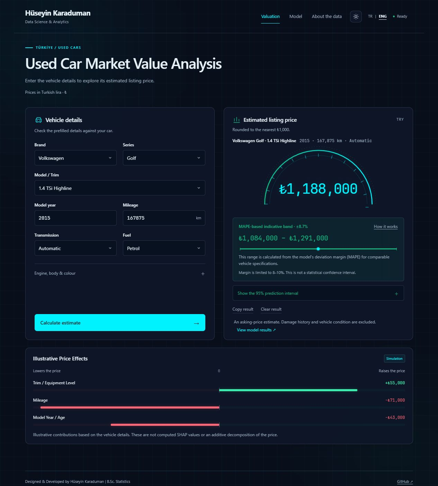
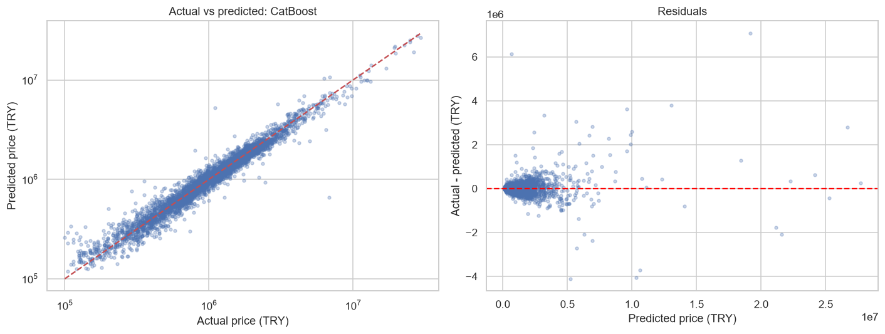

# İkinci El Araç Piyasa Değeri Analizi

**[Hüseyin Karaduman](https://github.com/hsynkrdmn) · Data Science & Analytics · B.Sc. Statistics**

Türkiye ikinci el araç ilanları üzerinde veri temizleme, model karşılaştırması ve fiyat tahmini. Eğitilmiş CatBoost modeli web arayüzünde doğrudan tarayıcıda çalışır; ziyaretçinin Python, API anahtarı veya IDE kullanması gerekmez.

## Web uygulamasını kullanma

<!-- live-demo:start -->
**[İnteraktif web uygulamasını aç](https://hsynkrdmn.github.io/used-car-price-prediction/)** · [GitHub deposu](https://github.com/hsynkrdmn/used-car-price-prediction)

Uygulama adresi GitHub Pages yayını etkinleştirildiğinde kullanılabilir. İlk kurulum adımları aşağıdadır; son yayın durumunu bu deponun **Deployments → github-pages** bölümünden kontrol edebilirsiniz.
<!-- live-demo:end -->

Arayüz Türkçe ve İngilizce kullanılabilir. Marka, seri, donanım, yıl ve kilometre bilgilerini düzenleyip **Fiyatı hesapla** düğmesine basın. Otomatik doldurulan bilgileri aracınızla karşılaştırın.

GitHub'ın dosya görüntüleyicisinde `index.html` dosyasını açmak uygulamayı çalıştırmaz. İnteraktif kullanım GitHub Pages bağlantısından yapılır.



## Arayüzde neler var?

- Gerçek CatBoost nokta tahmini; hesaplama tarayıcıda yapılır.
- Benzer marka/seri gruplarının MAPE değerinden hesaplanan, %8–10 ile sınırlandırılmış gösterge bandı.
- Ayrı açılır bölümde kalibre edilmiş, %95 kapsam hedefli tahmin aralığı.
- Donanım, kilometre ve yaş için açıkça **simülasyon** olarak işaretlenen temsili fiyat etkileri.
- Model sekmesinde CatBoost / LightGBM / XGBoost karşılaştırması ve ölçülen permütasyon önemi grafikleri.
- Yerel olarak hatırlanan dil tercihi; araç bilgileri bir tahmin servisine gönderilmez.

## Model sonuçları

Ham veri **26.533 ilan ve 26 sütun** içerir. Temizleme sonrası **20.069 eğitim** ve **5.011 test** ilanı kullanılır. Benzer araç özellikleri aynı grupta tutulur; eğitim ve test grupları kesişmez. Eksik değer doldurma, kodlama ve ölçekleme eğitim katları içinde öğrenilir.

Modeller `log1p(price_try)` öğrenir. Aşağıdaki fiyat hataları tekrar TL ölçeğine dönüştürülen tahminlerden hesaplanır. Seçim ölçütü test sonucu değil, beş katlı gruplu çapraz doğrulamadaki ortalama MAE'dir.

| Model | CV MAE (TL) | Test MAE (TL) | Test RMSE (TL) | Test R² |
| --- | ---: | ---: | ---: | ---: |
| **CatBoost** | **134.451** | **128.155** | **293.529** | **0,9589** |
| XGBoost | 141.666 | 136.375 | 315.408 | 0,9526 |
| LightGBM | 143.306 | 138.119 | 335.300 | 0,9464 |
| Ridge | 151.511 | 149.390 | 577.448 | 0,8411 |
| Lasso | 220.172 | 223.372 | 745.725 | 0,7350 |
| Medyan taban modeli | 682.787 | 691.303 | 1.462.958 | -0,0199 |

MAE ortalama mutlak hatadır; RMSE büyük hatalara daha fazla ağırlık verir. R² doğru tahmin yüzdesi değildir. Ayrıntılar [kaydedilmiş notebook](car_price_prediction.ipynb) ve [sonuç tablosunda](results/model_comparison.csv) bulunur.



## İki fiyat aralığının farkı

Orijinal test verisi araç gruplarına göre **2.500 kalibrasyon** ve **2.511 ayrı değerlendirme** ilanına ayrılır.

| Gösterim | Hesaplama | Ölçülen ilan kapsamı |
| --- | --- | ---: |
| Dar MAPE bandı | Aynı marka/seri MAPE'si; yeterli örnek yoksa marka, ardından genel veri. Gösterim marjı %8–10 ile sınırlandırılır. | %59,9 |
| %95 hedefli tahmin aralığı | Kalibrasyon gruplarındaki mutlak log-fiyat hatalarından sonlu örneklem düzeltmeli split conformal aralık. | %94,2 |

Dar MAPE bandı istatistiksel güven aralığı değildir. %95 hedefi de her araç için garanti anlamına gelmez. Değerlendirme fiyatları kalibrasyonda kullanılmaz. Temsili fiyat etkileri gerçek SHAP değerleri değildir; Model sekmesindeki özellik önemleri ise 600 ayrı değerlendirme ilanında üç tekrarla ölçülmüştür.

## Proje düzeni

```text
.github/workflows/pages.yml    # Kontroller ve GitHub Pages yayını
assets/preview.png            # README ekran görüntüsü
data/car_dataset_raw.csv      # Değiştirilmemiş ham ilan verisi
docs/                         # Web arayüzünün tek kaynak ve yayın klasörü
results/                      # Gerekli eğitim/test verileri ve analiz sonuçları
scripts/run_notebook.py       # Notebook'u Python kaynağından üretip çalıştırır
web-interface/                # Model dışa aktarma, kalibrasyon ve kontrol araçları
car_price_prediction.ipynb     # Kayıtlı analiz ve çıktılar
car_price_prediction.py        # Notebook'un hücre biçimli Python kaynağı
requirements.txt              # Analiz bağımlılıkları
```

`docs/` doğrudan yayınlanır; ikinci bir web kopyası veya frontend derleme adımı yoktur. Geliştirme ayrıntıları [web-interface/README.md](web-interface/README.md) dosyasındadır.

## GitHub Pages kurulumu — depo sahibi için

Bu işlem yalnızca ilk kurulumda gerekir. Sonrasında ziyaretçiler uygulamayı bağlantıdan doğrudan kullanır.

1. Bu klasörün güncel içeriğini, `.github/` dahil, deponun varsayılan dalına yükleyin. Eski dosyaları korumak yerine yeni klasör düzenini esas alın.
2. Depoda **Settings → Pages → Build and deployment → Source → GitHub Actions** seçin.
3. **Actions → Check and deploy GitHub Pages** iş akışını varsayılan dalda çalıştırın veya o dala yeni bir commit gönderin.
4. İş akışı tamamlandığında [canlı uygulama adresini](https://hsynkrdmn.github.io/used-car-price-prediction/) açın. Aynı adresi deponun **About → Website** alanına ekleyin. Bağlantı README'nin başında da yer alır.

İş akışı tahmin ve dosya kontrolleri geçtikten sonra yalnızca `docs/` içeriğini yayınlar. Ham veri, notebook ve geliştirme araçları siteye yüklenmez. Pull request'lerde kontroller çalışır; yayın yalnızca varsayılan daldan yapılır.

GitHub Pages ayarının etkinleştirilmesi dosya yüklemekten ayrı bir adımdır. [Resmî kurulum yönergesi](https://docs.github.com/en/pages/getting-started-with-github-pages/configuring-a-publishing-source-for-your-github-pages-site).

## Yerel çalıştırma

Web arayüzü için proje kökünde:

```bash
python -m http.server 8080 --directory docs
```

Tarayıcıda `http://localhost:8080` adresini açın. HTML dosyasına çift tıklamak yerine HTTP sunucusu kullanın.

Analizi yeniden çalıştırmak için:

```bash
python -m pip install -r requirements.txt notebook
python scripts/run_notebook.py
```

Alternatif olarak `car_price_prediction.ipynb` dosyasını proje kökünde çalışan Jupyter ile açabilirsiniz. Notebook'u yeniden çalıştırmak, kaydedilmiş sonuçları ve eğitim/test dosyalarını yeniler; web modelini yenilemek için ayrıca dışa aktarma adımını uygulayın.

## Kontroller ve web modelini yenileme

Web kontrolleri Node.js 24 ile çalışır; `npm install` gerekmez:

```bash
node web-interface/check_site.cjs
node web-interface/check_predictions.cjs
node web-interface/check_intervals.cjs
node web-interface/check_analytics.cjs
```

Modeli analiz kaynağından yeniden eğitip tarayıcıya aktarmak için Python bağımlılıkları ve Node.js gerekir:

```bash
python web-interface/export_model.py
```

Bu işlem `docs/` içindeki model, katalog, kalibrasyon ve analiz dosyalarını birlikte yeniler. Sonrasında kontrolleri tekrar çalıştırın. Yalnızca mevcut modelin analiz verilerini yenilemek için `node web-interface/build_analytics.cjs` kullanılabilir.

## Sınırlamalar

- Hedef, gerçekleşen satış fiyatı değil ilan fiyatıdır.
- Tramer ve hasar/kondisyon sütunları güvenilirlikleri doğrulanamadığı için dışlanmıştır. Ham veriler değiştirilmez; Tramer miktarına göre eğitim satırı silinmez.
- Hasar geçmişi, onarım kalitesi, konum ve fiziksel kondisyon tahmine dahil değildir.
- İlan tarihleri yoktur. Yüksek test R²'si bugünkü veya gelecekteki piyasa performansını kanıtlamaz.
- Kapsam, fiyatı 100.000–100.000.000 TL aralığındaki hazırlanmış ilanlardır; yaş hesabında referans yıl 2026'dır.
- Gruplar araç özelliklerinden türetilir; benzersiz araç kimliği veya VIN yerine geçmez. Proje profesyonel ekspertiz ya da satış garantisi sunmaz.
