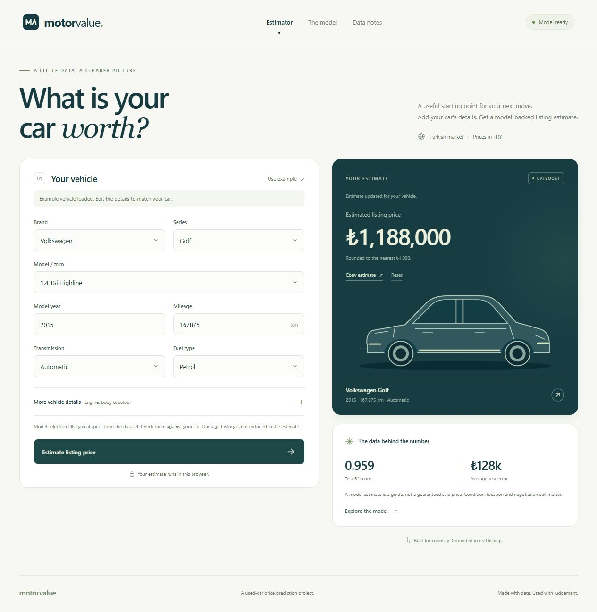
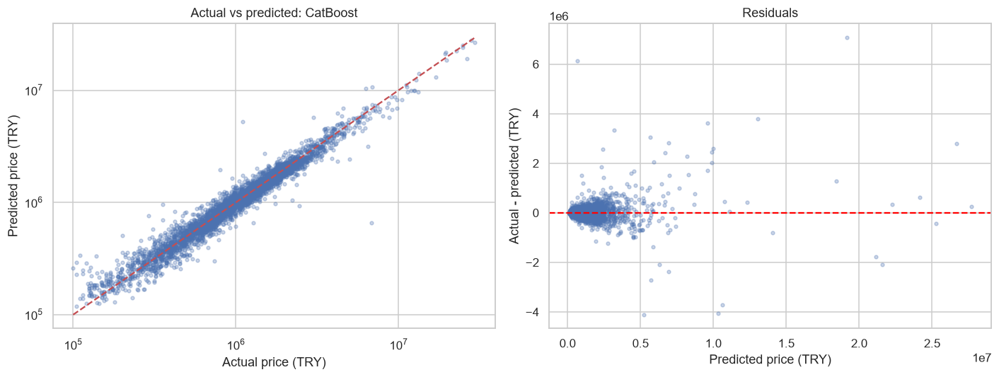

# Used Car Price Prediction

This project predicts used-car listing prices in Turkish lira (TRY). It includes data exploration, data cleaning, feature preparation, and a comparison of regression models.

The main goal is to build a clear machine learning workflow and understand how data quality affects the results.

## Web Interface

The interface runs the exported CatBoost model in the browser. Visitors do not need Python, an API key, or a prediction server. Damage history is not included.



## Dataset

The original dataset has **26,533 rows and 26 columns**. It includes:

- Brand, series, and model
- Year and mileage
- Transmission, fuel type, and body type
- Engine size and engine power
- Damage claim amount, stored as `tramer_tl`
- Listing price, stored as `price_try`

The target is `price_try`. Some category values are in Turkish, as they appear in the original data. Listing prices may differ from final sale prices.

## Project Steps

1. Check missing values, duplicate rows, and unusual values.
2. Remove unreliable columns and repeated rows.
3. Keep listings between TRY 100,000 and TRY 100,000,000.
4. Prepare the vehicle age feature. Damage history is excluded.
5. Split the data into training and test sets.
6. Compare models with five-fold cross-validation.
7. Evaluate the selected model on the test set and inspect its errors.

Rows with the same basic vehicle details stay in the same group during splitting. This reduces overlap between training and test data.

Missing numbers are filled with training-fold medians. Missing categories are filled with training-fold modes. Categories are one-hot encoded, and numeric features are scaled. These steps run inside a pipeline.

## Why Tramer Is Excluded

The raw dataset includes damage claim amounts (`tramer_tl`), but their meaning and quality could not be verified. The final model does not use tramer, a missing-tramer flag, a claim flag, or log tramer. Damage-condition fields are also excluded.

The raw CSV stays unchanged. Tramer is removed before duplicate checking in the prepared data. No tramer amount is changed to zero, capped, or used to remove training rows. No tramer feature is created.

**The estimate does not account for damage history, accident severity, or repair quality.** Similar model error does not mean that damage is unimportant in the real market.

## Models and Results

The project compares Ridge, Lasso, XGBoost, LightGBM, and CatBoost. A median prediction is included as a simple baseline.

Models learn log price. Predictions are converted back to TRY before calculating price errors. Model selection uses the lowest average cross-validation MAE, not the test score.

Results from the saved notebook run:

| Model | CV MAE (TRY) | Test MAE (TRY) | Test R² (TRY) |
|---|---:|---:|---:|
| CatBoost | 134,451 | 128,155 | 0.9589 |
| XGBoost | 141,666 | 136,375 | 0.9526 |
| LightGBM | 143,306 | 138,119 | 0.9464 |
| Ridge | 151,511 | 149,390 | 0.8411 |
| Lasso | 220,172 | 223,372 | 0.7350 |
| Median baseline | 682,787 | 691,303 | -0.0199 |

**CatBoost was selected by cross-validation.** Its test RMSE was approximately **TRY 293,529**. The final training set has **20,069 rows**, and the test set has **5,011 rows**.

MAE is the average absolute price error; lower is better. R² describes how well the predictions explain price variation. It is not a percentage of correct predictions.



## Files

| File | Description |
|---|---|
| [car-price-prediction.ipynb](car-price-prediction.ipynb) | Main notebook with saved outputs |
| [car_price_prediction.py](car_price_prediction.py) | Python version of the notebook cells |
| `car_dataset_raw.csv` | Original dataset |
| `requirements-car-price.txt` | Package versions used for the project |
| `run_simple_notebook.py` | Builds and runs the notebook from the Python file |
| `outputs_car_price_simple/` | Result tables, data files, and figures |
| `docs/` | Browser demo files |
| `web-interface/` | Web source, exporter, and prediction checks |

In the output folder, `car_dataset_cleaned.csv` contains **only the cleaned training subset**. The full prepared data and the test subset are saved separately as `car_dataset_prepared.csv` and `car_dataset_test.csv`.

## How to Run

### Web interface

The [MotorValue interface](web-interface/README.md) gives the model an English web form. It includes vehicle selection, a price estimate, model results, and data notes.

The trained CatBoost model runs in the browser. There is no separate prediction server.

```bash
python -m http.server 8080 --directory docs
```

Open `http://localhost:8080` in a browser. Typical vehicle specs are filled from the dataset, so check them before estimating.

### Analysis notebook

The saved analysis was run with Python 3.14.6 and the package versions in `requirements-car-price.txt`.

1. Download the project and open its folder in a terminal.
2. Install the packages and Jupyter Notebook:

   ```bash
   python -m pip install -r requirements-car-price.txt notebook
   ```

3. Keep `car_dataset_raw.csv` in the same folder as the notebook.
4. Open `car-price-analysis-simple.ipynb` in Jupyter or VS Code and run all cells in order.

To rebuild and run the notebook from the Python file:

```bash
python run_simple_notebook.py
```

## Limitations

- Damage history and condition are not model inputs. The estimate cannot measure a damage discount.
- Some raw tramer values may contain collection errors; they are excluded from the final workflow.
- Vehicle groups use listing details, not unique vehicle IDs.
- There are no listing dates, so the test does not measure performance on a future market.
- The models use mostly default settings. Hyperparameter tuning may improve the results.
- This is an educational project, not a professional vehicle valuation.
